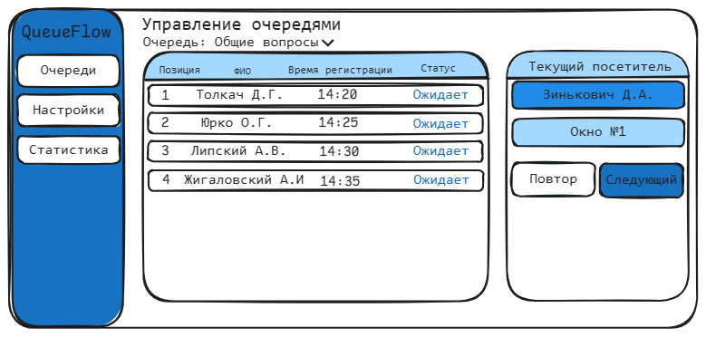
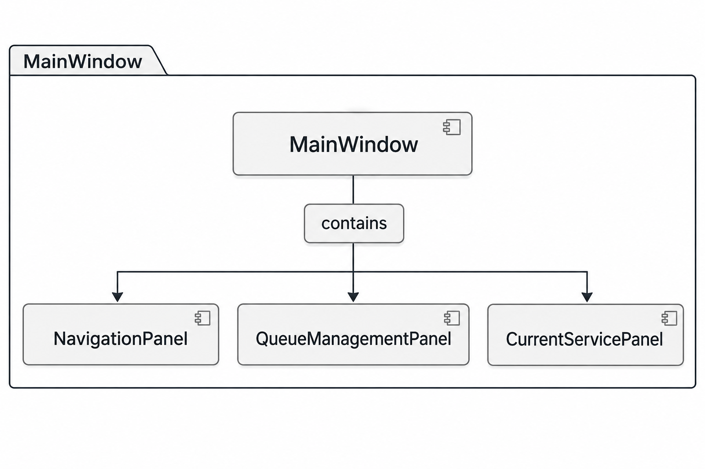

# Спецификация требований к ПО

## Для QueueFlow — веб-системы управления электронной очередью

**Версия:** 1.2

**Подготовил:** Хута Е.В.

**Группа:** 450504, **Вариант:** 28

**Учебное заведение:** БГУИР

**Дата изменения:** 5 ноября 2026 г.

---

## История изменений

| Автор | Дата | Причина изменения | Версия |
|:---|:---|:---|:---|
| Хута Е.В. | 04.11.2026 | Создание первоначальной спецификации требований к системе QueueFlow | 1.0 |
| Хута Е.В. | 05.11.2026 | Уточнение описания пользовательского интерфейса и оформление приложения А с графическим мокапом и структурной схемой SysML v2 | 1.1 |
| Хута Е.В. | 05.11.2026 | Учёт замечаний Заказчика: добавление фильтрации истории записей и уточнение информации, отображаемой на электронном табло | 1.2 |

---

## 1. Введение

Настоящий документ представляет собой спецификацию требований к программному обеспечению (Software Requirements Specification, SRS) для QueueFlow — веб-системы управления электронной очередью. Продукт предназначен для организации электронной регистрации посетителей, управления последовательностью обслуживания, вызова посетителей операторами и отображения актуального состояния очереди на электронном табло.

Система предназначена для организаций, в которых посетители обращаются за одной или несколькими услугами и должны обслуживаться в упорядоченной очереди. Регистрация и получение информации об очереди выполняются в электронном виде через веб-интерфейс. Выдача бумажных талонов и использование физических терминалов самообслуживания не предусматриваются.

### 1.1 Назначение документа

Настоящий документ определяет функциональные и нефункциональные требования к системе QueueFlow, ограничения её применения, внешние интерфейсы и критерии проверки реализации.

Документ служит основой для проектирования, разработки и тестирования системы, а также для согласования ожидаемого поведения программного продукта между разработчиком и проверяющей стороной. Требования сформулированы на уровне внешнего поведения системы и должны быть проверяемыми.

### 1.2 Область применения продукта

QueueFlow — веб-система, предназначенная для автоматизации процесса обслуживания посетителей по электронной очереди.

**В область применения продукта входит:**

- электронная регистрация посетителя через веб-страницу без создания учётной записи;
- выбор посетителем доступной услуги;
- создание электронной записи с уникальным кодом;
- отображение посетителю текущего состояния записи и количества записей, находящихся перед ним;
- формирование отдельных очередей по услугам;
- отображение оператору очередей по услугам, на обслуживание которых он назначен;
- ручной вызов оператором следующего посетителя;
- повторный вызов уже вызванного посетителя;
- перевод записи в состояние обслуживания и завершения обслуживания;
- фиксация неявки посетителя оператором;
- отображение последних вызовов, названий услуг и номеров окон на электронном табло;
- хранение истории регистрации и обслуживания;
- просмотр и фильтрация истории записей по временному периоду операторами и администраторами;
- администрирование услуг, операторов и окон обслуживания.

**В область применения продукта НЕ входит:**

- выдача бумажных талонов и печать талонов;
- использование физических терминалов или киосков для регистрации посетителей;
- автоматическое определение приоритета посетителя по социальному статусу или другим признакам;
- прогнозирование точного времени ожидания;
- автоматический вызов посетителей без действия оператора;
- интеграция с государственными информационными системами, CRM и внешними системами бронирования;
- приём платежей и выполнение финансовых операций;
- видеонаблюдение, распознавание лиц и биометрическая идентификация.

### 1.3 Определения, акронимы и сокращения

| Термин / аббревиатура | Определение |
|:---|:---|
| Электронная очередь | Упорядоченный набор активных записей посетителей, ожидающих обслуживания по определённой услуге. |
| Запись | Электронная сущность, создаваемая при регистрации посетителя и содержащая его данные, услугу, код и состояние. |
| Код записи | Уникальный буквенно-цифровой идентификатор, позволяющий посетителю найти свою запись в системе. Не является бумажным талоном. |
| Посетитель | Пользователь, который регистрируется на получение услуги и отслеживает состояние своей записи. |
| Оператор | Сотрудник, который вызывает посетителей и обслуживает их. |
| Администратор | Пользователь, управляющий услугами, учётными записями операторов и окнами обслуживания. |
| Окно обслуживания | Рабочее место оператора, обозначаемое номером или названием и отображаемое на электронном табло. |
| FIFO | First In, First Out — принцип обслуживания, при котором первым обслуживается посетитель, зарегистрировавшийся раньше остальных в очереди соответствующей услуги. |
| Табло | Экран, на котором отображаются последние вызовы посетителей, названия соответствующих услуг и окна обслуживания. |
| История записей | Сведения о ранее созданных записях и связанных с ними событиях регистрации и обслуживания. |
| SRS | Software Requirements Specification — спецификация требований к программному обеспечению. |
| SysML v2 | Systems Modeling Language Version 2 — язык системного моделирования. |
| UI | User Interface — пользовательский интерфейс. |
| API | Application Programming Interface — программный интерфейс приложения. |

### 1.4 Ссылки

1. Методические указания по дисциплине «Жизненный цикл разработки программного обеспечения» — в части выполнения лабораторных работ по анализу требований и проектированию ПО.
2. СТП 01–2024 «Дипломные проекты (работы). Общие требования». Минск, БГУИР, 2024 — при применимости требований оформления.
3. Официальная документация платформы .NET: https://learn.microsoft.com/dotnet/
4. Официальная документация ASP.NET Core: https://learn.microsoft.com/aspnet/core/
5. Официальная документация Blazor: https://learn.microsoft.com/aspnet/core/blazor/
6. Официальная документация SignalR: https://learn.microsoft.com/aspnet/core/signalr/

### 1.5 Обзор документа

Раздел 1 содержит назначение документа, область применения и терминологию. Раздел 2 описывает назначение системы, её функции, ограничения, пользователей и допущения. Раздел 3 содержит требования к внешним интерфейсам, функциональности и качеству обслуживания, а также проектные ограничения. Раздел 4 определяет методы проверки требований и матрицу трассируемости. Раздел 5 содержит приложение с описанием и структурной моделью пользовательского интерфейса на языке SysML v2.

---

## 2. Обзор продукта

### 2.1 Перспектива продукта

QueueFlow разрабатывается как самостоятельная клиент-серверная веб-система. Серверная часть отвечает за регистрацию посетителей, хранение записей, управление состояниями очередей, авторизацию сотрудников и передачу обновлений клиентским интерфейсам.

Посетитель взаимодействует с системой через веб-браузер на персональном компьютере, планшете или смартфоне. Оператор использует отдельный защищённый интерфейс для управления очередью. Администратор получает доступ к функциям настройки системы. Электронное табло открывается в браузере на экране, установленном в зоне ожидания.

Обновление информации о вызовах и состоянии очереди выполняется в режиме, близком к реальному времени, с использованием механизма двусторонней связи SignalR.

Система поддерживает несколько услуг и несколько операторов. Каждый оператор может быть назначен на одну или несколько услуг. Очередь ведётся отдельно для каждой услуги. Внутри очереди применяется принцип FIFO: следующей вызывается самая ранняя активная запись в состоянии ожидания.

### 2.2 Функции продукта

На основе проектируемого интерфейса QueueFlow предоставляет следующие ключевые возможности:

- **Регистрация посетителя:** ввод имени или отображаемого имени и выбор необходимой услуги без создания учётной записи.
- **Создание электронной записи:** формирование уникального кода записи и сохранение времени регистрации.
- **Просмотр состояния записи:** поиск записи по выданному коду и отображение её текущего статуса.
- **Отображение позиции в очереди:** расчёт количества посетителей, находящихся перед текущей записью в очереди выбранной услуги.
- **Управление очередью оператором:** просмотр ожидающих записей по назначенным услугам и вызов следующего посетителя.
- **Повторный вызов:** повторное отображение вызова посетителя без создания новой записи и без изменения её статуса.
- **Управление обслуживанием:** перевод вызванной записи в состояние обслуживания и последующее завершение обслуживания.
- **Фиксация неявки:** перевод вызванной записи в состояние «Не явился».
- **Электронное табло:** отображение последних трёх вызовов, кодов записей, названий соответствующих услуг и номеров окон обслуживания.
- **Администрирование:** создание, изменение и отключение услуг, управление операторами и окнами обслуживания.
- **История операций:** сохранение событий регистрации, вызова, повторного вызова, начала и завершения обслуживания, отмены и фиксации неявки.
- **Просмотр и фильтрация истории:** предоставление операторам и администраторам возможности просматривать историю записей и фильтровать её по заданному временному периоду.

### 2.3 Ограничения продукта

- **Технологический стек:** основной язык разработки — C#.
- **Платформа:** веб-приложение, доступное через современные браузеры на настольных и мобильных устройствах.
- **Серверная платформа:** ASP.NET Core на базе .NET 9.
- **Пользовательский интерфейс:** Blazor.
- **Обмен обновлениями:** SignalR.
- **Хранение данных:** SQLite с использованием Entity Framework Core для учебной версии.
- **Авторизация сотрудников:** ASP.NET Core Identity или эквивалентный механизм аутентификации.
- **Регистрация посетителя:** не требует создания личного кабинета; для просмотра записи используется её уникальный код.
- **Принцип очереди:** FIFO в пределах каждой услуги; приоритетные очереди в базовую версию не входят.
- **Вызов посетителя:** выполняется оператором вручную.
- **Отмена записи:** посетитель может самостоятельно отменить запись только до вызова, пока она находится в состоянии ожидания.
- **Повторная регистрация:** после отмены, завершения обслуживания или фиксации неявки посетитель может создать новую запись.
- **Физические талоны и терминалы:** не используются и не поддерживаются.
- **Время ожидания:** система отображает количество записей перед посетителем, но не рассчитывает и не обещает точное время ожидания.
- **История записей:** просмотр и фильтрация истории доступны операторам в рамках назначенных им услуг и администраторам в рамках всех услуг системы.

### 2.4 Характеристики пользователей

Основными категориями пользователей QueueFlow являются:

- **Посетители:** обладают базовыми навыками работы с веб-браузером. Могут открыть страницу регистрации, выбрать услугу, создать запись и проверить её состояние по уникальному коду.
- **Операторы:** сотрудники организации, обладающие навыками работы с веб-приложениями. Используют защищённый интерфейс для просмотра очередей назначенных услуг, вызова посетителей и фиксации результатов обслуживания.
- **Администраторы:** сотрудники, ответственные за настройку системы. Управляют перечнем услуг, учётными записями операторов и окнами обслуживания, а также имеют доступ к истории записей.

Интерфейс должен быть понятным и содержать однозначные подписи элементов управления. Основные действия должны быть доступны без необходимости изучения технической документации.

### 2.5 Допущения и зависимости

- Предполагается, что организация предоставляет посетителям доступ к веб-странице регистрации через локальную сеть или Интернет.
- Предполагается, что у посетителя имеется устройство с современным веб-браузером и доступом к сети.
- Предполагается, что оператор имеет персональную учётную запись и назначен администратором на одну или несколько услуг.
- Предполагается, что для каждой активной услуги существует хотя бы один оператор, имеющий право обслуживать эту услугу.
- Предполагается, что электронное табло представляет собой экран с устройством, способным открыть веб-браузер.
- Корректность обновления данных зависит от доступности сервера и сетевого соединения между сервером и клиентами.
- Уникальный код записи генерируется системой и не должен совпадать с кодом другой записи.
- Порядок FIFO определяется временем регистрации. При совпадении временных отметок используется внутренний порядковый идентификатор записи.
- Администратор отвечает за актуальность списка услуг, операторов и окон обслуживания.

### 2.6 Распределение требований

Разработка QueueFlow разделяется на следующие этапы:

- **Фаза 1 — анализ и проектирование:** анализ предметной области, формирование SRS, определение ролей и сценариев работы, создание мокапов интерфейсов, подготовка структурных и поведенческих моделей SysML v2/UML. На данном этапе программная реализация не является обязательной.
- **Фаза 2 — реализация:** разработка серверной части на C# и ASP.NET Core, пользовательских интерфейсов Blazor, механизма обновлений SignalR, базы данных и функций управления очередью.
- **Фаза 3 — проверка:** функциональное, интеграционное и нагрузочное тестирование, проверка разграничения прав доступа и корректности переходов состояний записей.
- **Возможные будущие итерации:** интеграция с внешними информационными системами, расширенная аналитика и отчёты, многофилиальная конфигурация и дополнительные способы уведомления посетителей. Эти функции не входят в базовый объём текущей версии.

---

## 3. Требования

Настоящий раздел определяет требования к внешним интерфейсам, функциональности и качеству обслуживания QueueFlow. Каждое требование имеет уникальный идентификатор и метод верификации.

### 3.1 Внешние интерфейсы

#### 3.1.1 Пользовательские интерфейсы

Система должна предоставлять четыре основных представления:

1. **Интерфейс посетителя:** страница выбора услуги и регистрации, страница подтверждения создания записи, страница просмотра состояния записи.
2. **Интерфейс оператора:** защищённая панель со списком назначенных услуг, ожидающими записями, текущим вызовом и действиями управления обслуживанием.
3. **Интерфейс администратора:** панель управления услугами, операторами и окнами обслуживания.
4. **Электронное табло:** публичная страница, отображающая последние три вызова, названия соответствующих услуг и окна обслуживания.

**Основные элементы интерфейса посетителя:**

- поле ввода имени или отображаемого имени;
- список доступных услуг;
- кнопка «Зарегистрироваться»;
- блок с уникальным кодом созданной записи;
- поле ввода кода записи для проверки состояния;
- индикатор статуса;
- текст с количеством посетителей перед текущей записью;
- кнопка «Отменить запись», доступная только до вызова.

**Основные элементы интерфейса оператора:**

- информация об авторизованном операторе;
- список услуг, на которые назначен оператор;
- список ожидающих записей выбранной услуги;
- кнопка «Вызвать следующего»;
- блок текущего вызова;
- кнопка «Повторить вызов»;
- кнопка «Начать обслуживание»;
- кнопка «Завершить обслуживание»;
- кнопка «Не явился»;
- раздел просмотра истории записей с возможностью фильтрации по временному периоду.

**Основные элементы интерфейса администратора:**

- раздел управления услугами;
- раздел управления учётными записями операторов;
- раздел управления окнами обслуживания;
- раздел просмотра истории записей;
- элементы выбора начальной и конечной даты для фильтрации истории.

**Основные элементы электронного табло:**

- заголовок организации или зоны обслуживания;
- список последних трёх вызовов;
- код каждой вызванной записи;
- название услуги, к которой относится вызов;
- номер или название окна обслуживания;
- визуальное выделение последнего вызова.

Структурная модель, приведённая ниже, описывает главное окно интерфейса оператора и его три основные панели. Интерфейсы посетителя, администратора и электронного табло являются отдельными представлениями системы.

**Структурная спецификация интерфейса на языке SysML v2:**

```sysml
package QueueFlowUI {

    part def NavigationPanel;

    part def QueueManagementPanel;

    part def CurrentServicePanel;

    part def MainWindow {
        part navigationPanel : NavigationPanel;

        part queueManagementPanel : QueueManagementPanel;

        part currentServicePanel : CurrentServicePanel;
    }

}
```

Примечание: приведённый фрагмент фиксирует структуру элементов интерфейса и предназначен для дальнейшего оформления и проверки в инструменте, поддерживающем SysML v2. Он не заменяет графический макет.

#### 3.1.2 Аппаратные интерфейсы

Система не требует специализированного оборудования и не взаимодействует с устройствами выдачи талонов.

Для работы используются стандартные устройства:

- сервер или компьютер, на котором размещается серверная часть приложения;
- персональные компьютеры операторов;
- смартфоны, планшеты или компьютеры посетителей;
- экран или телевизор с устройством, способным отображать веб-страницу электронного табло;
- стандартное сетевое оборудование для обмена данными.

Взаимодействие с устройствами осуществляется через стандартные сетевые интерфейсы и веб-браузеры.

#### 3.1.3 Программные интерфейсы

Система взаимодействует со следующим программным обеспечением:

- **Операционная система сервера:** ОС, поддерживающая запуск .NET 9 Runtime.
- **.NET 9:** среда выполнения серверного приложения.
- **ASP.NET Core:** обработка HTTP-запросов, маршрутизация, серверная логика и авторизация.
- **Blazor:** построение интерактивных пользовательских интерфейсов.
- **SignalR:** передача обновлений состояния очереди и вызовов клиентским интерфейсам.
- **Entity Framework Core:** доступ к данным и выполнение операций с базой данных.
- **SQLite:** хранение услуг, пользователей, записей очереди и истории событий.
- **Веб-браузеры:** доступ посетителей, операторов и администраторов к системе.

Обмен данными между клиентом и сервером выполняется по HTTP/HTTPS. Для передачи обновлений в реальном времени используется SignalR.

### 3.2 Функциональные требования

#### Регистрация и просмотр очереди

- **ID:** REQ-FUNC-001-01

  **Title:** Просмотр доступных услуг

  **Statement:** Система должна отображать посетителю список активных услуг, доступных для электронной регистрации. Неактивные услуги не должны быть доступны для создания новых записей.

  **Verification Method:** Demonstration.

- **ID:** REQ-FUNC-002-01

  **Title:** Регистрация посетителя

  **Statement:** Система должна позволять посетителю создать электронную запись без создания личной учётной записи путём ввода имени или отображаемого имени и выбора услуги.

  **Verification Method:** Test.

- **ID:** REQ-FUNC-003-01

  **Title:** Генерация кода записи

  **Statement:** После успешной регистрации система должна создавать уникальный код записи и отображать его посетителю на странице подтверждения.

  **Verification Method:** Test.

- **ID:** REQ-FUNC-004-01

  **Title:** Просмотр состояния записи

  **Statement:** Система должна позволять посетителю получить состояние своей записи по её уникальному коду.

  **Verification Method:** Demonstration.

- **ID:** REQ-FUNC-005-01

  **Title:** Отображение позиции в очереди

  **Statement:** Для записи в состоянии ожидания система должна отображать количество записей той же услуги, зарегистрированных раньше и ещё ожидающих вызова. Система не должна отображать неподтверждённое прогнозное время ожидания.

  **Verification Method:** Test.

- **ID:** REQ-FUNC-006-01

  **Title:** Самостоятельная отмена записи

  **Statement:** Система должна позволять посетителю отменить собственную запись, если она находится в состоянии ожидания. После вызова оператором самостоятельная отмена посетителем не допускается.

  **Verification Method:** Test.

#### Управление очередью оператором

- **ID:** REQ-FUNC-007-01

  **Title:** Просмотр назначенных услуг

  **Statement:** Система должна отображать оператору только те услуги, на обслуживание которых он назначен администратором.

  **Verification Method:** Test.

- **ID:** REQ-FUNC-008-01

  **Title:** Вызов следующего посетителя

  **Statement:** По команде оператора система должна выбирать самую раннюю запись в состоянии ожидания среди записей выбранной услуги и переводить её в состояние «Вызван».

  **Verification Method:** Test.

- **ID:** REQ-FUNC-009-01

  **Title:** Повторный вызов посетителя

  **Statement:** Система должна позволять оператору повторно вызвать текущую запись в состоянии «Вызван» без создания новой записи и без изменения её статуса.

  **Verification Method:** Demonstration.

- **ID:** REQ-FUNC-010-01

  **Title:** Начало обслуживания

  **Statement:** Система должна позволять оператору перевести вызванную запись из состояния «Вызван» в состояние «Обслуживается».

  **Verification Method:** Test.

- **ID:** REQ-FUNC-011-01

  **Title:** Завершение обслуживания

  **Statement:** Система должна позволять оператору завершить обслуживание записи, находящейся в состоянии «Обслуживается», с переводом её в состояние «Завершена».

  **Verification Method:** Test.

- **ID:** REQ-FUNC-012-01

  **Title:** Фиксация неявки посетителя

  **Statement:** Система должна позволять оператору отметить неявку посетителя, если запись находится в состоянии «Вызван». После фиксации неявки запись переводится в конечное состояние «Не явился».

  **Verification Method:** Test.

#### Электронное табло и администрирование

- **ID:** REQ-FUNC-013-01

  **Title:** Отображение информации о вызовах на табло

  **Statement:** Система должна отображать на электронном табло последние три вызова с указанием кода записи, названия соответствующей услуги и номера или названия окна обслуживания.

  **Verification Method:** Demonstration.

- **ID:** REQ-FUNC-014-01

  **Title:** Обновление табло в реальном времени

  **Statement:** При создании нового вызова система должна обновлять содержимое электронного табло без необходимости ручной перезагрузки страницы пользователем.

  **Verification Method:** Demonstration.

- **ID:** REQ-FUNC-015-01

  **Title:** Управление услугами

  **Statement:** Система должна предоставлять администратору возможность создавать, изменять и деактивировать услуги. Деактивация услуги не должна удалять историю ранее созданных записей.

  **Verification Method:** Test.

- **ID:** REQ-FUNC-016-01

  **Title:** Управление операторами и окнами

  **Statement:** Система должна предоставлять администратору возможность создавать и изменять учётные записи операторов, назначать им одну или несколько услуг и связывать их с окнами обслуживания.

  **Verification Method:** Test.

- **ID:** REQ-FUNC-017-01

  **Title:** Ведение истории операций

  **Statement:** Система должна сохранять историю событий записи, включая регистрацию, вызов, повторный вызов, начало обслуживания, завершение обслуживания, отмену и фиксацию неявки. Для события должны сохраняться тип события, дата и время, а для действий сотрудника — идентификатор сотрудника.

  **Verification Method:** Inspection.

- **ID:** REQ-FUNC-018-01

  **Title:** Повторная регистрация посетителя

  **Statement:** Система должна разрешать создание новой записи после того, как предыдущая запись посетителя перешла в конечное состояние «Отменена», «Завершена» или «Не явился».

  **Verification Method:** Test.

- **ID:** REQ-FUNC-019-01

  **Title:** Разделение очередей по услугам

  **Statement:** Система должна вести отдельную последовательность ожидания для каждой услуги. Вызов следующего посетителя должен выполняться только в рамках выбранной оператором услуги.

  **Verification Method:** Test.

- **ID:** REQ-FUNC-020-01

  **Title:** Разграничение доступа по ролям

  **Statement:** Система должна разграничивать доступ к функциям посетителя, оператора и администратора. Операции управления услугами и учётными записями должны быть доступны только администратору.

  **Verification Method:** Test.

- **ID:** REQ-FUNC-021-01

  **Title:** Фильтрация истории записей

  **Statement:** Система должна предоставлять операторам и администраторам возможность просматривать историю записей и фильтровать её по временному периоду с указанием начальной и конечной даты. Оператору должны быть доступны записи только по услугам, на обслуживание которых он назначен, а администратору — история записей всех услуг. Конечная дата выбранного периода не должна предшествовать начальной.

  **Verification Method:** Test.

**Состояния электронной записи**

| Состояние | Описание |
|:---|:---|
| Ожидает | Запись создана и ожидает вызова оператором. |
| Вызван | Оператор вызвал посетителя; запись ожидает начала обслуживания. |
| Обслуживается | Оператор начал обслуживание посетителя. |
| Завершена | Обслуживание успешно завершено. |
| Отменена | Посетитель самостоятельно отменил запись до вызова. |
| Не явился | Оператор зафиксировал отсутствие посетителя после вызова. |

Допустимые переходы состояний:

- `Ожидает → Вызван` — оператор вызывает следующего посетителя.
- `Ожидает → Отменена` — посетитель отменяет собственную запись до вызова.
- `Вызван → Обслуживается` — оператор начинает обслуживание.
- `Вызван → Не явился` — оператор фиксирует неявку.
- `Обслуживается → Завершена` — оператор завершает обслуживание.

Повторный вызов не является переходом состояния: запись остаётся в состоянии «Вызван», а событие повторного вызова добавляется в историю.

Записи в состояниях «Завершена», «Отменена» и «Не явился» являются конечными. Для получения услуги после завершения или отмены посетитель создаёт новую запись.

### 3.3 Качество обслуживания

#### 3.3.1 Производительность

- **REQ-PERF-001-01:** При штатной нагрузке до 100 одновременно подключённых клиентских сессий основные операции регистрации, просмотра состояния записи и вызова следующего посетителя должны обрабатываться не более чем за 2 секунды, без учёта задержки сети.
- **REQ-PERF-002-01:** Обновление электронного табло после вызова посетителя должно отображаться подключённым клиентам не позднее чем через 2 секунды после фиксации события сервером.
- **REQ-PERF-003-01:** Пересчёт количества посетителей перед записью должен выполняться на основании актуального состояния очереди и завершаться не более чем за 1 секунду при объёме до 1 000 активных записей.

#### 3.3.2 Безопасность

- **REQ-SEC-001-01:** Доступ к интерфейсам оператора и администратора должен предоставляться только после успешной аутентификации.
- **REQ-SEC-002-01:** Система должна проверять права пользователя на выполнение каждой операции управления очередью и административной настройки.
- **REQ-SEC-003-01:** Оператор должен иметь возможность выполнять действия только в отношении услуг, на которые он назначен.
- **REQ-SEC-004-01:** Публичное электронное табло должно отображать код записи, название услуги и окно обслуживания, но не должно отображать полное имя посетителя.
- **REQ-SEC-005-01:** Код записи должен быть достаточно уникальным, чтобы исключить неоднозначное обращение к записи в рамках системы.

#### 3.3.3 Надёжность

- **REQ-REL-001-01:** Система должна сохранять запись и её начальное состояние при успешной регистрации; посетителю нельзя показывать подтверждение регистрации до успешного сохранения данных.
- **REQ-REL-002-01:** Система должна предотвращать одновременный вызов одной и той же ожидающей записи несколькими операторами.
- **REQ-REL-003-01:** При временной потере соединения клиентский интерфейс должен сообщать о потере связи и восстанавливать получение актуальных данных после повторного подключения.
- **REQ-REL-004-01:** Ошибка выполнения отдельной операции не должна приводить к некорректному изменению состояния других записей очереди.

#### 3.3.4 Доступность

- **REQ-AVAIL-001-01:** Система должна быть доступна пользователям через веб-браузер при наличии сетевого соединения с сервером.
- **REQ-AVAIL-002-01:** При перезапуске серверного приложения сохранённые записи и история операций должны оставаться доступными после восстановления соединения с базой данных.
- **REQ-AVAIL-003-01:** Публичное табло должно открываться в режиме просмотра без авторизации и не предоставлять возможности изменения данных.

#### 3.3.5 Наблюдаемость

- **REQ-OBS-001-01:** Система должна регистрировать ошибки серверной части с указанием даты, времени и контекста операции.
- **REQ-OBS-002-01:** Система должна сохранять историю значимых операций с электронной записью согласно требованию REQ-FUNC-017-01.
- **REQ-OBS-003-01:** Система должна фиксировать неуспешные попытки входа сотрудников в журнал безопасности.

### 3.4 Соответствие стандартам

При разработке и документировании QueueFlow должны учитываться:

1. Методические указания по дисциплине «Жизненный цикл разработки программного обеспечения».
2. СТП 01–2024 БГУИР — в части требований к оформлению проектной и технической документации, если данный стандарт применяется к выполняемой лабораторной работе.
3. Рекомендации OWASP по безопасной разработке веб-приложений — в части аутентификации, управления сессиями, контроля доступа и обработки пользовательского ввода.
4. Документация .NET и ASP.NET Core — в части использования платформы и её программных интерфейсов.

### 3.5 Проектирование и реализация

#### 3.5.1 Установка

Система разворачивается на сервере организации. Посетителям, операторам и администраторам не требуется устанавливать отдельное настольное приложение. Для работы достаточно современного веб-браузера и сетевого подключения к серверу.

#### 3.5.2 Сборка и поставка

Серверная часть разрабатывается на C# с использованием .NET 9 и ASP.NET Core. Сборка выполняется средствами .NET CLI. Клиентские интерфейсы поставляются как часть веб-приложения.

#### 3.5.3 Распределение

Система имеет клиент-серверную архитектуру:

- сервер приложения выполняет бизнес-логику и обрабатывает запросы;
- база данных хранит услуги, учётные записи сотрудников, записи очереди и историю операций;
- клиентские браузеры отображают интерфейсы посетителя, оператора, администратора и табло;
- SignalR обеспечивает доставку обновлений подключённым клиентам.

#### 3.5.4 Сопровождаемость

При разработке рекомендуется разделять приложение на логические слои:

- **Presentation:** страницы и компоненты Blazor;
- **Application:** сценарии регистрации, управления очередью и обслуживания;
- **Domain:** сущности и правила предметной области;
- **Infrastructure:** база данных, репозитории, аутентификация и интеграция SignalR.

Бизнес-правила переходов состояний должны быть отделены от визуальных компонентов интерфейса. Это упрощает тестирование и последующее изменение системы.

#### 3.5.5 Повторное использование

Логика работы с очередью, расчёта позиции посетителя и управления переходами состояний должна проектироваться в виде независимых сервисов и компонентов .NET, пригодных для повторного использования в разных интерфейсах системы.

#### 3.5.6 Переносимость

Веб-клиент должен работать в актуальных версиях распространённых браузеров на Windows, Linux, macOS, Android и iOS. Серверная часть должна запускаться на операционных системах, поддерживаемых .NET 9.

#### 3.5.7 Стоимость

Для базовой учебной версии должны использоваться доступные средства разработки и библиотеки, не требующие обязательной оплаты лицензий. Использование платных внешних API не предусматривается.

#### 3.5.8 Сроки

Разработка и проверка проектной документации выполняются в сроки, установленные графиком лабораторных работ. Реализация программного продукта относится к последующему этапу жизненного цикла, если иное не предусмотрено заданием преподавателя.

#### 3.5.9 Доказательство концепции

Для подтверждения реализуемости основных технических решений должен быть подготовлен прототип, демонстрирующий:

- создание электронной записи посетителем;
- сохранение записи в базе данных;
- получение оператором списка ожидающих записей;
- вызов следующего посетителя по принципу FIFO;
- изменение статуса записи;
- передачу обновлённого вызова на электронное табло через SignalR.

#### 3.5.10 Управление изменениями

Изменения требований и программного кода должны фиксироваться в системе контроля версий Git. Существенные изменения функциональности должны сопровождаться обновлением SRS, моделей системы и тестовых сценариев. Для командной разработки рекомендуется использовать отдельные ветки и Pull Request.

### 3.6 ИИ/МО

Использование методов искусственного интеллекта и машинного обучения в базовой версии QueueFlow не предусматривается. Порядок очереди определяется детерминированным алгоритмом FIFO, без прогнозирования поведения посетителей или автоматического назначения приоритетов.

---

## 4. Верификация

В таблице представлена матрица трассируемости и верификации требований QueueFlow. Статус Planned означает, что проверка запланирована и будет выполнена на этапе реализации и тестирования.

| Requirement ID | Verification Method | Test/Artifact Link | Status | Evidence |
|:---|:---|:---|:---|:---|
| REQ-FUNC-001-01 | Demonstration | tests/ServicesList.md | Planned | Отображение активных услуг |
| REQ-FUNC-002-01 | Test | tests/VisitorRegistration.md | Planned | Успешная регистрация без учётной записи |
| REQ-FUNC-003-01 | Test | tests/RegistrationCode.md | Planned | Генерация уникального кода |
| REQ-FUNC-004-01 | Demonstration | tests/RegistrationStatus.md | Planned | Поиск записи по коду |
| REQ-FUNC-005-01 | Test | tests/QueuePosition.md | Planned | Корректный расчёт количества записей впереди |
| REQ-FUNC-006-01 | Test | tests/VisitorCancellation.md | Planned | Отмена только ожидающей записи |
| REQ-FUNC-007-01 | Test | tests/OperatorServices.md | Planned | Проверка назначенных услуг |
| REQ-FUNC-008-01 | Test | tests/CallNext.md | Planned | Вызов самой ранней ожидающей записи |
| REQ-FUNC-009-01 | Demonstration | tests/RepeatCall.md | Planned | Повторный вызов без смены статуса |
| REQ-FUNC-010-01 | Test | tests/StartService.md | Planned | Переход в состояние обслуживания |
| REQ-FUNC-011-01 | Test | tests/CompleteService.md | Planned | Завершение обслуживания |
| REQ-FUNC-012-01 | Test | tests/NoShow.md | Planned | Фиксация неявки |
| REQ-FUNC-013-01 | Demonstration | tests/PublicDisplay.md | Planned | Отображение трёх последних вызовов, кодов записей, названий услуг и номеров окон |
| REQ-FUNC-014-01 | Demonstration | tests/SignalRUpdates.md | Planned | Обновление табло без перезагрузки |
| REQ-FUNC-015-01 | Test | tests/ServiceManagement.md | Planned | Управление услугами |
| REQ-FUNC-016-01 | Test | tests/OperatorManagement.md | Planned | Назначение операторов и окон |
| REQ-FUNC-017-01 | Inspection | tests/OperationHistory.md | Planned | Наличие истории событий |
| REQ-FUNC-018-01 | Test | tests/ReRegistration.md | Planned | Повторная регистрация после конечного статуса |
| REQ-FUNC-019-01 | Test | tests/ServiceQueues.md | Planned | Независимые очереди услуг |
| REQ-FUNC-020-01 | Test | tests/RoleAccess.md | Planned | Проверка разграничения ролей |
| REQ-FUNC-021-01 | Test | tests/HistoryDateFilter.md | Planned | Фильтрация истории по периоду и проверка разграничения доступа |
| REQ-PERF-001-01 | Test | tests/Performance.md | Planned | Время ответа основных операций |
| REQ-PERF-002-01 | Test | tests/DisplayLatency.md | Planned | Задержка обновления табло |
| REQ-PERF-003-01 | Test | tests/QueuePositionPerformance.md | Planned | Время расчёта позиции |
| REQ-SEC-001-01 | Test | tests/Authentication.md | Planned | Доступ к интерфейсам сотрудников |
| REQ-SEC-002-01 | Test | tests/Authorization.md | Planned | Проверка прав пользователя |
| REQ-SEC-003-01 | Test | tests/OperatorScope.md | Planned | Ограничение оператора назначенными услугами |
| REQ-SEC-004-01 | Inspection | tests/PublicDisplayPrivacy.md | Planned | Отображение кода записи, названия услуги и окна без имени посетителя |
| REQ-SEC-005-01 | Test | tests/UniqueCodes.md | Planned | Проверка уникальности кода |
| REQ-REL-001-01 | Test | tests/RegistrationPersistence.md | Planned | Сохранение записи до подтверждения |
| REQ-REL-002-01 | Test | tests/ConcurrentCall.md | Planned | Защита от двойного вызова |
| REQ-REL-003-01 | Demonstration | tests/Reconnection.md | Planned | Восстановление соединения |
| REQ-REL-004-01 | Test | tests/OperationIsolation.md | Planned | Изоляция ошибок операций |
| REQ-AVAIL-001-01 | Demonstration | tests/WebAccess.md | Planned | Доступ через браузер |
| REQ-AVAIL-002-01 | Test | tests/RestartPersistence.md | Planned | Сохранность данных после перезапуска |
| REQ-AVAIL-003-01 | Inspection | tests/DisplayReadOnly.md | Planned | Отсутствие функций изменения на табло |
| REQ-OBS-001-01 | Inspection | logs/queueflow.log | Planned | Запись ошибок сервера |
| REQ-OBS-002-01 | Inspection | tests/EventAudit.md | Planned | Сохранение истории операций |
| REQ-OBS-003-01 | Inspection | logs/security.log | Planned | Запись неуспешных попыток входа |

---

## 5. Приложения

### Приложение А

#### (обязательное)

#### Прототип и структурная спецификация графического интерфейса QueueFlow

**1. Визуальный мокап пользовательского интерфейса (Excalidraw):**



**2. Структурная спецификация интерфейса на языке SysML v2:**



Примечание: настоящий графический макет разработан на этапе анализа требований для наглядного представления интерфейса оператора QueueFlow. Он является предварительным прототипом и не представляет собой окончательный дизайн пользовательского интерфейса. Формальная структурная спецификация главного окна оператора на языке SysML v2 приведена в подразделе 3.1.1. Изображения хранятся в каталоге `images` относительно файла спецификации, поэтому GitHub отображает их непосредственно в документе Markdown при сохранении указанной структуры репозитория.

---

**Конец спецификации.**